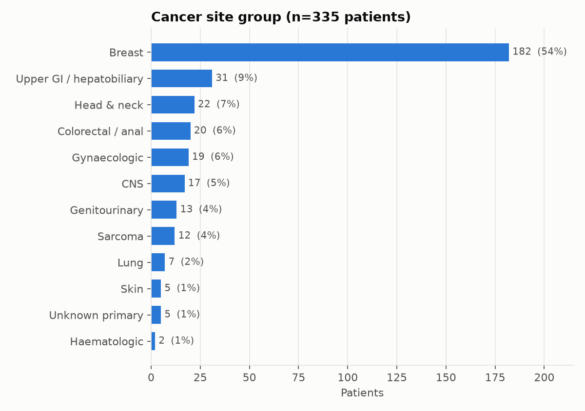
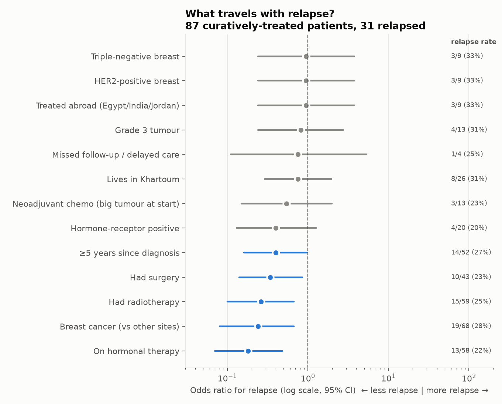
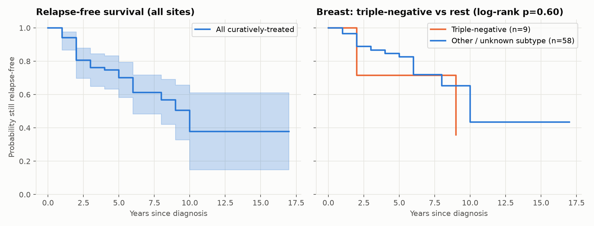
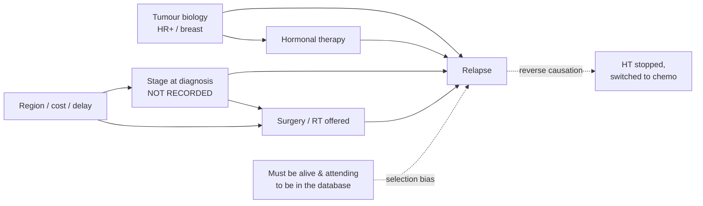

# Cancer Recurrence — Correlation vs Causation (Sudan oncology clinic data)

A data project built on a real appointment-booking database from an oncology clinic in Sudan
(2020–2021). It asks **"Once someone has had cancer and finished treatment, what is associated
with the cancer coming back, and how much of that can we call cause and effect?"** It also
generates de-identified **synthetic patients** so the work can be shared and extended.

```
bookingtreat.sql  ──►  clean_anonymize.py  ──►  extract_features.py  ──►  analysis.py  ──►  reports/
 (raw, PRIVATE)        de-identify, dedupe       clinical-note NLP         stats, KM,        figures, tables,
                       → patients_clean.csv      → patients_features.csv   confounding       results.json
                                                          │
                                                          └──►  synthesize.py  ──►  data/synthetic/
```

Run everything: `./run_all.sh` (needs `python -m venv .venv && .venv/bin/pip install -r requirements.txt`).

> **Data in this repository.** The raw database and the per-patient clinical notes are **not** published.
> This repo contains the code, aggregate results, a **k-anonymous** feature table
> (`data/public/patients_features_public.csv`: every combination of site group, region, sex and
> diagnosis period is shared by ≥ 3 patients) and **5,000 synthetic patients**
> (`data/synthetic/`). `run_all.sh` needs the private dump; everything downstream can be explored
> from the public files.

---

## 1. What was in the database

| Table | Rows | Used? | Notes |
|---|---|---|---|
| `patients` | 352 | ✅ | name, residence, file no., phone ×2, diagnosis, **free-text clinical summary**, `ses`, `age` |
| `appointments` | 1,270 | ✅ | patient, clinic unit, date, slot |
| `unitdrs` | 6 | ✅ | unit codes: Chemotherapy, Hormonal/Survivors, Oncology Consultant, Palliative Care |
| `timeslots` | 42 | — | 10-minute slots, not analytically useful |
| `users` | 1 | ❌ dropped | admin login + unsalted SHA-1 password hash (security risk, never export) |
| `account`, `extrasummary`, `units` | 0 | — | empty |

**Data-quality findings**
- `age` is **0 for every real patient** → unusable. Age is only recoverable from 2 notes.
- There is **no sex column**. Sex is inferred from cancer site and pronouns (206 F, 28 M, 101 unknown).
- **There is no stage column.** `ses` (I/II/IV/V) is *not* stage: it doesn't track metastasis,
  palliative referral or site. It is kept as an opaque `ses_code` (possibly socio-economic class).
  **Ask the clinic what it means.**
- 352 rows → **335 real patients** after merging duplicate entries (shared hospital file no.,
  or same booking no. + same name). Booking no. 91 was **reused for two different people**,
  so it isn't trusted on its own.
- 1 test record removed (diagnosis "هو دايما مبسوط" — "he's always happy").
- 20 appointments couldn't be linked to exactly one patient and were dropped.
- **All the clinical value is in the free-text `summary`** — diagnosis dates, receptors,
  metastases, treatments, relapse. That's why step 2 is a text-mining step.

## 2. De-identification (what was removed)

| Identifier | Action |
|---|---|
| Patient names, phone 1 & 2, hospital file no., internal ids | **dropped**; replaced with random `P0001…` ids |
| Residence (town / neighbourhood, Arabic + English) | generalised to **7 regions** (Khartoum, Central, Darfur, Kordofan, Northern, Eastern, South Sudan/abroad) |
| Dates in notes (`dd/mm/yyyy`, glued `dmyyyy`, `Mon yyyy`…) | reduced to **year only** |
| Appointment dates | replaced by **days since first visit** + year |
| Clinician names in notes (`Dr …`, `Prof …`) | `[CLINICIAN]` |
| Small towns mentioned in notes | `[TOWN]` |
| Admin password hash | not exported |

`clean_anonymize.py` ends with an **automatic audit** that fails the run if anything
phone-like, a full date, a clinician name or Arabic text (names) survives.
⚠️ The raw `bookingtreat.sql` and everything in `data/processed/` stay private (`.gitignore`), and a
git pre-commit hook (`scripts/privacy_check.py`) blocks commits containing phone-like numbers,
full dates or Arabic-script names. Only the k-anonymous export (`src/export_public.py`) and
synthetic data are published.

## 3. Factors extracted from the notes (`patients_features.csv`, 60 columns)

- **Cancer:** site group / site, histology, grade, ER / PR / HER2, breast subtype (triple-negative, HER2+, HR+)
- **Spread:** metastasis to bone / liver / lung / brain / lymph node, *metastatic at diagnosis*, locally advanced
- **Treatment:** surgery, chemotherapy (neo-/adjuvant), radiotherapy, hormonal therapy, anti-HER2,
  zoledronic acid, opioids, palliative referral, ≥2nd-line chemo, treated abroad
- **Course & access:** diagnosis year, years since diagnosis, missed follow-up / delayed care
- **Booking behaviour:** number of visits, units seen, moved from survivorship clinic → chemo/palliative
- **Outcomes**
  - `relapse` — **"Did the cancer come back?"** Defined only for patients who had
    curative-intent treatment, were **not** metastatic at diagnosis, and either relapsed or are ≥1 year out.
    → **87 patients, 31 relapsed (36%)**.
  - `progression_if_metastatic` — for the 64 patients who were already stage-IV at diagnosis (17 progressed).

All rules are plain regexes in `src/extract_features.py`, so a clinician can audit and fix them.

## 4. Findings

### Who is in this clinic (n = 335)
- **54% breast cancer**, then upper-GI / liver (9%), head & neck (7%), colorectal (6%), gynaecological (6%).
- Patients come from all over Sudan: only 25% from Khartoum, and 18% from Darfur.
- **32% have documented metastases**, and 19% were already metastatic at diagnosis (late presentation).
- Receptor status is stated for only **58 of 182 breast patients**. That is the single biggest data gap.



### What moves together (correlation, `07_correlation_heatmap.png`)
Strongest pairs (phi): breast–female 0.85 · bone mets–zoledronic acid 0.59 · breast–hormonal therapy 0.55 ·
recurrence/progression–metastatic 0.47 · hormonal therapy–≥5 yrs since diagnosis 0.43 ·
breast–palliative referral −0.37. Most of these are **treatment following diagnosis**
(bone mets → zoledronic acid), not risk factors.

### "Will it come back?" — relapse after curative treatment (n = 87, 31 events)

| Factor | Relapse with | Relapse without | Odds ratio (95% CI) | FDR p |
|---|---|---|---|---|
| On hormonal therapy | 13/58 (22%) | 18/29 (62%) | **0.18** (0.07–0.48) | 0.009 |
| Breast (vs other sites) | 19/68 (28%) | 12/19 (63%) | **0.24** (0.08–0.67) | 0.03 |
| Had radiotherapy | 15/59 (25%) | 16/28 (57%) | **0.26** (0.10–0.67) | 0.03 |
| Had surgery | 10/43 (23%) | 21/44 (48%) | 0.34 (0.14–0.85) | 0.08 |
| Hormone-receptor positive | 4/20 (20%) | 27/67 (40%) | 0.40 (0.13–1.27) | 0.25 |
| Triple-negative breast | 3/9 (33%) | 28/78 (36%) | 0.95 (0.24–3.79) | 1.0 |



**Relapse-free survival** (Kaplan–Meier, from diagnosis): **81% at 2 yrs, 70% at 5 yrs, 57% at 8 yrs**.
Triple-negative vs other breast cancers: no detectable difference (p = 0.60, but only 9 TNBC patients).



Multivariable logistic model (years since diagnosis, breast, TNBC, hormonal therapy, radiotherapy):
radiotherapy OR 0.28 (0.09–0.86) stays significant. Hormonal therapy OR 0.14 (0.01–1.37) loses
significance once site and radiotherapy are in the model.

## 5. Correlation ≠ causation — what this data can and cannot say



**Worked example: does hormonal therapy *cause* less relapse?** (`tables/confounding_hormonal_therapy.csv`)

| Analysis | OR for relapse on hormonal therapy |
|---|---|
| Crude | 0.18 (0.07–0.48) |
| Stratified by site & receptor status (Mantel–Haenszel) | **0.28 (0.09–0.88)** |

Part of the apparent effect (about a quarter, on the log-odds scale) was **confounding**: hormonal therapy is only given to breast and
hormone-positive cancers, which relapse less anyway. Three more biases this data cannot remove:
1. **Confounding by stage.** Surgery and radiotherapy are offered to operable, earlier-stage disease.
   Stage isn't recorded, so "surgery → less relapse" partly means "earlier stage → less relapse".
2. **Reverse causation.** When cancer relapses, hormonal tablets are often *stopped* and chemo
   started, so notes for relapsed patients mention HT less.
3. **Selection / survivor bias.** Only patients alive and attending in 2020–21 are in the database.
   Long-term survivors come for annual follow-up, and patients who died earlier are invisible.

**What is reasonable to conclude:** the direction of the hormonal-therapy and radiotherapy
associations **agrees with randomised-trial evidence** (endocrine therapy and adjuvant RT reduce
recurrence), so they are *consistent with* a causal effect. This dataset alone cannot prove it.
The non-finding for triple-negative breast cancer (known to relapse earlier) is most likely
**too few documented receptor results**, not true absence.

## 6. Synthetic data (`data/synthetic/synthetic_patients.csv`)

`synthesize.py` fits a **Gaussian copula** to 32 structured factors, applies clinical logic
(site↔sex, receptor fields only for breast, eligibility), then draws the **relapse outcome from a
logistic model fitted on the real cohort**, so risk-factor relationships are preserved.
Free text is *not* synthesised.

| Check | Real | Synthetic (n = 5,000) |
|---|---|---|
| Mean marginal distance (TVD) | — | 0.055 |
| Mean \|correlation difference\| | — | 0.095 |
| Relapse rate | 35.6% | 35.4% |
| OR hormonal therapy / radiotherapy / breast | 0.18 / 0.26 / 0.24 | 0.20 / 0.32 / 0.32 |
| Exact copies of real patients | — | **0** |
| Synthetic rows closer than the 5th-pct real↔real distance | — | 0.6% |

Known limitations: the synthetic "metastatic" share runs high (40% vs 32%) and per-site metastasis
flags run low. With n = 335, the generator can only reproduce what the real data supports.
**Never use synthetic data to make clinical claims.** Use it to build and test pipelines,
dashboards and models.

## 7. Next steps
1. **Ask the clinic** what `ses` means, and whether stage, age and date of death exist elsewhere.
   These three variables would change the analysis most.
2. **LLM-assisted extraction:** have Claude re-read each note into a strict JSON schema and compare it with
   the regex features (inter-rater agreement), with a clinician resolving disagreements.
3. **LLM-generated synthetic notes:** condition Claude on each synthetic row to write a realistic
   clinical summary. This yields a fully synthetic, shareable text + tabular dataset.
4. Prediction model for relapse (penalised logistic / survival model) trained on synthetic data and
   validated on real data, reported with calibration, not just accuracy.

## Project layout
```
src/parse_sql.py          read the MySQL dump without a database server
src/clean_anonymize.py    de-identify, merge duplicates, generalise geography & dates
src/extract_features.py   clinical-note NLP → 60 structured factors + outcomes
src/analysis.py           profile, correlations, odds ratios, KM, confounding demo
src/synthesize.py         Gaussian-copula + outcome-model synthetic generator, with validation
src/export_public.py      k-anonymous public release of the feature table
scripts/privacy_check.py  pre-commit guard against leaking private data
data/processed/           PRIVATE (not in repo): clean notes, appointments, full features
data/public/              patients_features_public.csv (k ≥ 3)
data/synthetic/           synthetic_patients.csv
PLAN.md                   roadmap (8-stage framework: access → … → recommend)
reports/figures/          10 PNG charts
reports/tables/           odds ratios, correlation matrix, confounding table
reports/results.json      every number quoted above
```
