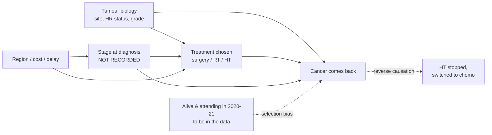
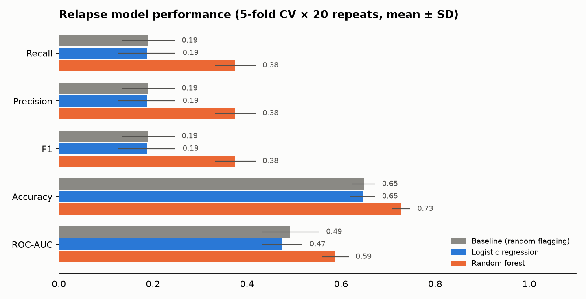
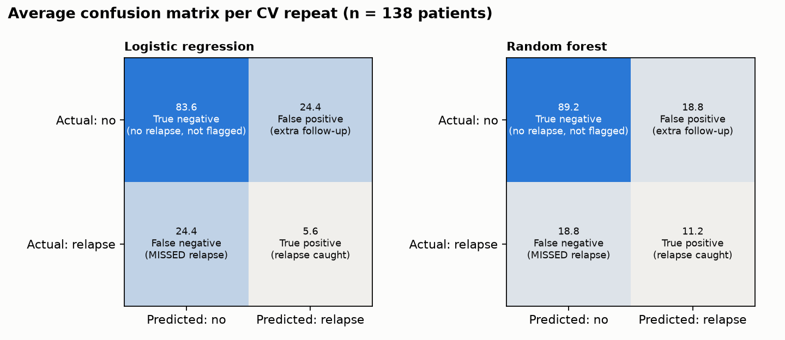

# Will the cancer come back? Correlation vs causation on real clinic data

**The premise:** if someone has had cancer and was treated, **will the cancer come back?**
For every factor linked to it coming back, is that link **just a correlation**, or is it
plausibly **cause and effect**?

Data: a real appointment-booking database from an oncology clinic in Sudan (2020–2021),
de-identified. 335 patients; the clinical facts come from free-text doctors' notes.

## The answer in one screen

| Question | Answer from this data |
|---|---|
| How many treated patients saw their cancer come back? | **30 of 138 (22%)** at-risk patients |
| How likely is it to stay away? | Relapse-free: **87% at 2 years, 78% at 5 years, 48% at 10 years** (Kaplan–Meier) |
| What is clearly linked to it coming back? | **Cancer type.** Breast cancer came back less than other cancers (hazard ratio 0.33, 95% CI 0.16–0.70). This is a **risk marker**, not a cause you can change. |
| Do treatments *cause* fewer relapses? | Hormonal therapy (HR 0.36) and radiotherapy (HR 0.55) point to fewer relapses, the **same direction as clinical trials**, but their confidence intervals include "no effect". **This data cannot separate them from chance or confounding.** |
| Everything else (surgery, grade, triple-negative, region, treated abroad…) | **No clear link** in either direction (too few patients to tell) |
| Can we predict who will relapse? | **Only weakly.** Cross-validated time-aware model: C-index 0.63 (0.5 = coin flip) |
| Getting a *new* (second) cancer? | Only 4 patients mention one, too few to analyse |
| Why can't it prove causation? | 30 relapses (detecting a halving of risk needs ~66), **no stage, no age, no date of death**, and only survivors attending in 2020–21 are in the data |

> **Correction (v2).** An earlier version defined the at-risk group differently for patients with
> and without relapse (non-relapsers had to have "curative" treatment detected; relapsers did not).
> Every untreated patient in that group was therefore a relapse, which made surgery,
> radiotherapy and hormonal therapy look strongly protective (e.g. hormonal therapy OR 0.18) and
> gave a prediction model a false AUC of 0.71. With one rule for everyone, those effects shrink to
> what's shown above. The bug and its fix are in `src/extract_features.py`.

These are associations from one clinic, **not medical advice**.

```
bookingtreat.sql  ──►  clean_anonymize.py  ──►  extract_features.py  ──►  analysis.py  ──►  reports/
 (raw, PRIVATE)        de-identify, dedupe       clinical-note NLP         stats, KM,        figures, tables,
                       → patients_clean.csv      → patients_features.csv   confounding       results.json
                                                          │
                                                          └──►  synthesize.py  ──►  data/synthetic/
```

Run everything: `./run_all.sh` (needs `python -m venv .venv && .venv/bin/pip install -r requirements.txt`).

> **Data in this repository.** The raw database and the per-patient clinical notes are **not** published.
> This repo contains the code, aggregate results, a **k-anonymous** feature table
> (`data/public/patients_features_public.csv`: every combination of site group, region, sex and
> diagnosis period is shared by ≥ 3 patients) and **5,000 synthetic patients**
> (`data/synthetic/`). `run_all.sh` needs the private dump; everything downstream can be explored
> from the public files.

---

## 1. What was in the database

| Table | Rows | Used? | Notes |
|---|---|---|---|
| `patients` | 352 | ✅ | name, residence, file no., phone ×2, diagnosis, **free-text clinical summary**, `ses`, `age` |
| `appointments` | 1,270 | ✅ | patient, clinic unit, date, slot |
| `unitdrs` | 6 | ✅ | unit codes: Chemotherapy, Hormonal/Survivors, Oncology Consultant, Palliative Care |
| `timeslots` | 42 | — | 10-minute slots, not analytically useful |
| `users` | 1 | ❌ dropped | admin login + unsalted SHA-1 password hash (security risk, never export) |
| `account`, `extrasummary`, `units` | 0 | — | empty |

**Data-quality findings**
- `age` is **0 for every real patient** → unusable. Age is only recoverable from 2 notes.
- There is **no sex column**. Sex is inferred from cancer site and pronouns (206 F, 28 M, 101 unknown).
- **There is no stage column.** `ses` (I/II/IV/V) is *not* stage: it doesn't track metastasis,
  palliative referral or site. It is kept as an opaque `ses_code` (possibly socio-economic class).
  **Ask the clinic what it means.**
- 352 rows → **335 real patients** after merging duplicate entries (shared hospital file no.,
  or same booking no. + same name). Booking no. 91 was **reused for two different people**,
  so it isn't trusted on its own.
- 1 test record removed (diagnosis "هو دايما مبسوط" — "he's always happy").
- 20 appointments couldn't be linked to exactly one patient and were dropped.
- **All the clinical value is in the free-text `summary`** — diagnosis dates, receptors,
  metastases, treatments, relapse. That's why step 2 is a text-mining step.

## 2. De-identification (what was removed)

| Identifier | Action |
|---|---|
| Patient names, phone 1 & 2, hospital file no., internal ids | **dropped**; replaced with random `P0001…` ids |
| Residence (town / neighbourhood, Arabic + English) | generalised to **7 regions** (Khartoum, Central, Darfur, Kordofan, Northern, Eastern, South Sudan/abroad) |
| Dates in notes (`dd/mm/yyyy`, glued `dmyyyy`, `Mon yyyy`…) | reduced to **year only** |
| Appointment dates | replaced by **days since first visit** + year |
| Clinician names in notes (`Dr …`, `Prof …`) | `[CLINICIAN]` |
| Small towns mentioned in notes | `[TOWN]` |
| Admin password hash | not exported |

`clean_anonymize.py` ends with an **automatic audit** that fails the run if anything
phone-like, a full date, a clinician name or Arabic text (names) survives.
⚠️ The raw `bookingtreat.sql` and everything in `data/processed/` stay private (`.gitignore`), and a
git pre-commit hook (`scripts/privacy_check.py`) blocks commits containing phone-like numbers,
full dates or Arabic-script names. Only the k-anonymous export (`src/export_public.py`) and
synthetic data are published.

## 3. Factors extracted from the notes (`patients_features.csv`, 60 columns)

- **Cancer:** site group / site, histology, grade, ER / PR / HER2, breast subtype (triple-negative, HER2+, HR+)
- **Spread:** metastasis to bone / liver / lung / brain / lymph node, *metastatic at diagnosis*, locally advanced
- **Treatment:** surgery, chemotherapy (neo-/adjuvant), radiotherapy, hormonal therapy, anti-HER2,
  zoledronic acid, opioids, palliative referral, ≥2nd-line chemo, treated abroad
- **Course & access:** diagnosis year, years since diagnosis, missed follow-up / delayed care
- **Booking behaviour:** number of visits, units seen, moved from survivorship clinic → chemo/palliative
- **Outcomes**
  - `relapse` + `rfs_years`: **"Did the cancer come back, and when?"** Defined with **one rule for
    everyone**: malignant, **not** metastatic at diagnosis, received any cancer treatment, diagnosed
    ≥ 1 year before the note → **138 at-risk patients, 30 relapsed (22%)**. Time = years from diagnosis
    to relapse (or to the note, if no relapse).
  - `progression_if_metastatic` — for the 64 patients who were already stage-IV at diagnosis (17 progressed).

All rules are plain regexes in `src/extract_features.py`, so a clinician can audit and fix them.

## 4. Context: who is in this clinic (n = 335)
- **54% breast cancer**, then upper-GI / liver (9%), head & neck (7%), colorectal (6%), gynaecological (6%).
- Patients come from all over Sudan: only 25% from Khartoum, and 18% from Darfur.
- **32% have documented metastases**, and 19% were already metastatic at diagnosis (late presentation).
  Those patients are *excluded* from the "come back" question, since their cancer never went away.
- Receptor status is stated for only **58 of 182 breast patients**. That is the single biggest data gap.


## 5. Will it come back? How often and how fast


- 138 at-risk patients, median follow-up 4 years, 30 relapses.
- Relapse-free: **87% at 2 yrs, 78% at 5 yrs, 48% at 10 yrs** (few patients are followed past 10 years,
  so the tail is uncertain).
- Breast cancers come back later and less often than other cancers (log-rank p = 0.002).
- A **survival (time-to-event) analysis** is used because follow-up ranges from 1 to 17 years.
  "No relapse yet" after 1 year is not the same as "no relapse" after 10.

## 6. Correlation or causation? Factor by factor

For each factor: the **crude** link (correlation), the link **adjusted** for measured confounders
(Cox model), the **E-value** (how strong an unmeasured confounder such as stage would need to be to
explain the adjusted link away), and outside evidence. Full table: `reports/tables/correlation_vs_causation.csv`.


| Factor | Relapse with / without | Crude HR | Adjusted HR (for) | E-value | Verdict |
|---|---|---|---|---|---|
| Breast cancer (vs other) | 19% / 27% | 0.33 (0.16–0.70) | — | 3.65 | **Risk marker**: real link, not modifiable |
| Hormonal therapy *(breast)* | 17% / 24% | 0.38 (0.14–1.01) | 0.36 (0.12–1.04) *(HR status, surgery, RT)* | 3.45 | Points to fewer relapses, matching trials; **not provable here** |
| Radiotherapy | 18% / 27% | 0.54 (0.27–1.11) | 0.55 (0.26–1.16) *(site, surgery)* | 2.40 | Points to fewer relapses, matching trials; **not provable here** |
| Surgery | 23% / 21% | 0.78 (0.37–1.65) | 0.78 (0.36–1.67) *(site)* | 1.66 | No clear link |
| Triple-negative *(breast)* | 19% / 19% | 1.24 (0.36–4.21) | 1.30 (0.33–5.12) *(grade)* | 1.69 | No clear link. Trials say TNBC relapses more; only 16 TNBC patients here |
| Grade 3 | 20% / 22% | 0.68 (0.24–1.90) | 0.91 (0.31–2.66) *(site)* | 1.33 | No clear link |
| Treated abroad / Khartoum / missed follow-up | — | ≈ 0.5–1.3, all CIs cross 1 | — | — | No clear link |

**How to read the verdict.**
- A **correlation** is any link in the crude column.
- For a **cause**, we need the link to survive adjustment, to come before the outcome in time,
  to be strong enough that hidden confounders can't explain it, and to agree with outside evidence.
- Hormonal therapy and radiotherapy pass "time order" and "outside evidence" but fail "survives
  chance": their intervals include 1. To exclude chance, an unmeasured confounder like **stage**
  would also have to be ruled out. The E-value says it would need to be linked to both treatment
  and relapse by a factor of about 3.5 (hormonal therapy) or 2.4 (radiotherapy) to explain the
  point estimate away. That is plausible for stage, so we can't rule it out.



**Biases this data cannot remove**
1. **Confounding by stage.** Stage isn't recorded, and it drives both which treatment is offered and relapse.
2. **Reverse causation.** After a relapse, hormonal tablets are often stopped and chemo started,
   so the note's treatment list partly reflects the relapse.
3. **Survivor / selection bias.** Only patients alive and attending in 2020–21 are in the
   database. Patients who relapsed and died earlier are missing, so 22% *understates* relapse.
4. **Too few events.** Detecting a halving of risk (HR 0.5) with 80% power needs ~66 relapses;
   HR 0.7 needs ~247. We have 30.

## 7. Predicting relapse: model & evaluation (`src/model.py`)

**Clinic question:** can we rank treated patients by risk so follow-up goes to the highest-risk first?

- Target: `relapse` / `rfs_years` (138 patients, 30 relapses). Features: only facts known before
  relapse. Metastasis flags, palliative referral, opioids, zoledronic acid, 2nd-line chemo and visit
  counts are excluded as **leakage**.
- Validation: 5-fold stratified cross-validation × 20 repeats. Runs on the public k-anonymous file.

| Model | Metric | Result | Random flagging |
|---|---|---|---|
| **Cox model** (site, grade, treatments), time-aware | C-index | **0.63 ± 0.03** | 0.50 |
| Cox model, breast vs other only | C-index | 0.59 ± 0.02 | 0.50 |
| Random forest (relapse yes/no) | ROC-AUC | 0.59 | 0.49 |
| Logistic regression (relapse yes/no) | ROC-AUC | 0.47 | 0.49 |

Flagging the top 22% riskiest (= relapse rate), the random forest catches 38% of relapses
(precision 0.38), vs 19% for random flagging. Full operating points: `tables/model_operating_points.csv`.




**Verdict:** with this data, relapse is **only weakly predictable**, and most of the signal is
cancer type. The yes/no models are close to chance, partly because they can't tell "not relapsed"
from "not followed long enough". That is why the time-aware Cox model is the primary result.
**Not fit for clinical use.** This is mainly a data problem: stage, age and receptor status are missing.

## 8. Synthetic data (`data/synthetic/synthetic_patients.csv`)

`synthesize.py` fits a **Gaussian copula** to 32 structured factors, applies clinical logic
(site↔sex, receptor fields only for breast, eligibility), then draws the **relapse outcome from a
logistic model fitted on the real cohort**, so risk-factor relationships are preserved.
Free text is *not* synthesised.

| Check | Real | Synthetic (n = 5,000) |
|---|---|---|
| Mean marginal distance (TVD) | — | 0.055 |
| Mean \|correlation difference\| | — | 0.092 |
| Relapse rate (at-risk cohort) | 21.7% | 21.6% |
| OR hormonal therapy / radiotherapy / breast | 0.69 / 0.59 / 0.63 | 0.66 / 0.63 / 0.59 |
| Exact copies of real patients | — | **0** |
| Synthetic rows closer than the 5th-pct real↔real distance | — | 0.3% |

Known limitations: the synthetic "metastatic" share runs high (41% vs 32%). Training on synthetic data and
testing on real gives AUC 0.53, i.e. the synthetic data carries the same (weak) signal as the real data,
no more. **Never use synthetic data to make clinical claims.**

## 9. Recommendation
1. **To the clinic: record the facts that make this question answerable.** Add structured fields for
   **stage, age, ER/PR/HER2, date of relapse and date of death**. Receptor status is missing for 68% of
   breast patients, and stage and age are missing for everyone.
2. **Use cancer type for follow-up planning.** Non-breast cancers came back sooner and more often.
   That's the one link this data supports.
3. **Don't read the treatment results as proof.** Hormonal therapy and radiotherapy point the same way as
   clinical trials, so there is no reason to doubt them. But this dataset cannot confirm them.
4. **Re-run when ~66+ relapses are recorded** with stage and age, and validate any risk model on new patients.

Roadmap and status: see [PLAN.md](PLAN.md).

## Project layout
```
src/parse_sql.py          read the MySQL dump without a database server
src/clean_anonymize.py    de-identify, merge duplicates, generalise geography & dates
src/extract_features.py   clinical-note NLP → 60 structured factors + outcomes
src/analysis.py           the premise: KM, crude vs adjusted Cox, E-values, verdict per factor
src/model.py              relapse prediction: Cox (C-index), logistic / random forest, repeated CV, TSTR
src/synthesize.py         Gaussian-copula + outcome-model synthetic generator, with validation
src/export_public.py      k-anonymous public release of the feature table
scripts/privacy_check.py  pre-commit guard against leaking private data
data/processed/           PRIVATE (not in repo): clean notes, appointments, full features
data/public/              patients_features_public.csv (k ≥ 3)
data/synthetic/           synthetic_patients.csv
PLAN.md                   roadmap (8-stage framework: access → … → recommend)
reports/figures/          10 PNG charts
reports/tables/           odds ratios, correlation matrix, confounding table
reports/results.json      every number quoted above
```
